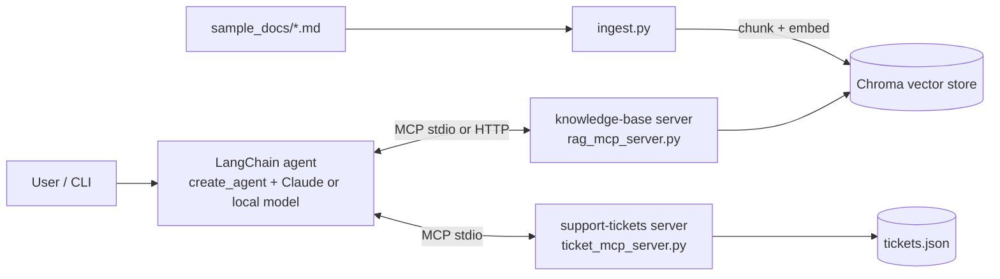

# Agentic RAG with LangChain and MCP

A small but complete example of an agent that answers questions from a document knowledge base (RAG) and takes actions, where every capability reaches the agent through the Model Context Protocol (MCP). The agent is built with LangChain's `create_agent`; the tools come from two MCP servers loaded with `langchain-mcp-adapters`.

The demo domain is a fictional support desk ("Acme Co"): the agent looks up refund, shipping and product policies, cites the passages it used, and opens a support ticket when a request qualifies.

## Architecture



There are three moving parts. The ingestion step (`ingest.py`) reads Markdown and text files, splits them into overlapping chunks, embeds them and stores them in a persistent Chroma collection. The MCP servers wrap capabilities as tools: `rag_mcp_server.py` exposes `search_knowledge_base` and `list_knowledge_sources`, and `ticket_mcp_server.py` exposes `create_ticket` and `get_ticket`. The agent (`agent.py`) connects to both servers, turns their tools into LangChain tools, and runs a tool-calling loop: the model decides when to search, reads the passages, decides whether an action is needed, and writes a cited answer.

What makes this "agentic" rather than classic RAG is that retrieval is a tool the model chooses to call, possibly several times with refined queries, and it can combine retrieval with actions. Classic RAG retrieves once, unconditionally, before generation.

Putting retrieval behind MCP means the knowledge base is a reusable service. The same server works from this agent, from Claude Desktop, from Claude Code or from any other MCP client, and it can be moved to its own machine (see "Running the RAG server over HTTP") without changing agent code.

## Project layout

```
rag_mcp_agent/
├── agent.py              LangChain agent, MCP client wiring, CLI
├── models.py             Chat model factory (Claude, Ollama, LM Studio, OpenAI-compatible)
├── rag_mcp_server.py     MCP server: retrieval tools over the vector store
├── ticket_mcp_server.py  MCP server: support ticket actions
├── ingest.py             Builds the vector index from a docs folder
├── knowledge_base.py     Opens the vector store (shared by ingest and server)
├── config.py             Settings from environment / .env, logging setup
├── sample_docs/          Demo documents
└── tests/                Unit tests for ingestion
```

## Quick start

Requires Python 3.10 or newer.

```bash
python -m venv .venv
source .venv/bin/activate          # Windows: .venv\Scripts\activate
pip install -r requirements.txt

cp .env.example .env               # then set ANTHROPIC_API_KEY
python ingest.py                   # first run downloads the ~90 MB embedding model
python agent.py                    # interactive chat
python agent.py "How long does express shipping take for a 7 kg parcel?"
```

Questions worth trying, each exercising a different path:

```
What's the battery life of the Aurora headphones with noise cancelling on?
jane@example.com received unopened headphones 20 days ago and wants a refund. If she qualifies, open a ticket.
My opened Nimbus speaker works fine, can I return it after 10 days?
Do you sell gift cards?
```

The first is a plain lookup. The second makes the agent retrieve the policy, reason about eligibility and then call `create_ticket`. The third requires combining two policy rules (opened items vs. electronics). The last has no answer in the documents, so the agent should say so instead of inventing one.

While it runs, the CLI prints each tool call (`->`) and a preview of each tool result (`<-`), so you can watch the agent's decisions.

Add `--debug` to see what happens inside each model call:

```bash
python agent.py --debug "How long does express shipping take for a 7 kg parcel?"
```

```
  [thinking] The user asks about express shipping, so I should search the policy...
  [model] tokens in=754 out=63 reasoning=27 finish_reason=tool_calls
  -> search_knowledge_base({'query': 'express shipping weight limits'})
  [mcp] knowledge_base.search_knowledge_base request: {"query": "express shipping weight limits"}
  [mcp] knowledge_base.search_knowledge_base response after 0.02 s (ok: text, 548 chars, structured content)
  <- search_knowledge_base [success]: [shipping.md#0] (relevance 0.64) ...full text...
  [thinking] Express takes 1-2 days; 7 kg falls in the up-to-20 kg tier...

Assistant: Express shipping takes 1-2 business days [shipping.md#0]...
  [model] tokens in=963 out=128 reasoning=73 finish_reason=stop
```

Debug mode streams everything the model generates as it is generated: its reasoning (`[thinking]`) and its text (`Assistant:`), including text written alongside a tool call, which normal mode hides. After every model call it prints token usage and the finish reason (`[model]`). Every MCP round trip is traced (`[mcp]`): the request is printed before it is sent, then the response with its duration and the shape of the result. Tool results are printed in full, and errors include tracebacks. Together these show where a slow run spends its time. If the reasoning stops growing, the model server is stuck. If a `[mcp] ... request` line has no matching response, the MCP server is stuck. A `finish_reason` of `length` means the model ran out of output tokens or context.

Reasoning appears for models that expose it: thinking models on LM Studio or other OpenAI-compatible servers (their `reasoning_content` field), Ollama with `CHAT_REASONING=true`, and Claude with extended thinking enabled.

Two problems are reported in every mode, because otherwise a run would just end with no answer. `!! malformed tool call` means the model produced a tool call whose arguments could not be parsed. `!! The model returned neither an answer nor a tool call` usually means a thinking model wrote its tool call inside its reasoning rather than as a real tool call. Run with `--debug` to see it.

## How a request flows

When the agent starts, `MultiServerMCPClient` launches each stdio server as a subprocess (or connects over HTTP), and `load_mcp_tools` converts each MCP tool into a LangChain `BaseTool`, using the tool's docstring as its description and its type hints as its argument schema. Those descriptions are what the model reads when deciding which tool to call, so they are written as instructions to the model.

For each question, `create_agent` runs a loop: the model either answers or emits tool calls, the tools execute through MCP, their results are appended to the conversation as tool messages, and the model is called again. The loop ends when the model replies without tool calls, or when `MAX_AGENT_STEPS` is hit. An `InMemorySaver` checkpointer keyed by a thread id keeps conversation history across turns, so follow-ups like "and what about express?" work.

## Design decisions

**One live session per server.** `client.get_tools()` is the shortest way to load MCP tools, but tools loaded that way open a new session for every call, which for stdio servers means spawning a fresh process (and reloading the embedding model) on every search. `agent.py` instead opens one session per server with `client.session(...)` inside an `AsyncExitStack` and loads tools from those sessions, so each server starts once and is shut down cleanly on exit.

**stdout belongs to the protocol.** A stdio MCP server speaks JSON-RPC over stdout, so any stray `print` corrupts the stream. Never print from server code; use `logging`, which FastMCP sends to stderr. The servers set FastMCP's log level to `WARNING` to keep the agent's console readable.

**Heavy libraries load before the server starts serving.** `rag_mcp_server.py` loads the embedding model and runs one search before `mcp.run()`, rather than on the first tool call. On Windows, loading the embedding stack imports native libraries for the first time (sentence-transformers pulls in scikit-learn and SciPy, whose BLAS DLL initialises a Fortran runtime). Over the stdio transport, a background thread is meanwhile blocked reading stdin. A blocking read on a Windows pipe also blocks other operations on that handle, so the DLL's start-up code waits forever and the first tool call never returns. Loading everything before stdin is read avoids the deadlock. It also makes the server fail at start-up with a clear message when the index is missing, and keeps the first question as fast as the rest. The cost is that the agent takes a few seconds longer to start. Any new stdio server that imports native libraries lazily needs the same treatment.

**Retrieval says when it found nothing.** Results below `MIN_RELEVANCE` (cosine similarity, 0 to 1) are dropped, and if nothing remains the tool returns an explicit "no relevant passages" message. Returning weakly related chunks invites the model to stitch an answer together from them. The threshold depends on the embedding model, so tune it against your own documents.

**Citations are stable ids.** Each chunk is stored with the id `source#chunk` (for example `refund_policy.md#0`), the same id the tool prints and the model cites. Ingestion resets the collection and re-inserts with these ids, so re-running it is safe and removes chunks of deleted files.

**Tool errors go back to the model.** Servers raise `ValueError` for bad input. MCP reports these as tool errors, and the adapter (with its default `handle_tool_errors=True`) returns them to the model as an error tool message instead of crashing the run, so the model can correct the call or explain the problem.

**Least-privilege environment for stdio servers.** Spawned servers receive only a minimal set of environment variables from the MCP SDK, not the agent's full environment (so your Anthropic key is not passed to them). The servers therefore load `.env` themselves by absolute path. If a server needs a secret, such as an API key for a hosted embedding model, put it in `.env` rather than only exporting it in your shell.

**Side effects are deliberate.** The ticket tool's description tells the model to check the policy first, and its MCP annotations mark it as not read-only so clients can treat it with care. For production, add human approval before side-effecting calls (see "Extending").

## Configuration

All settings come from environment variables or `.env`. Relative paths are resolved against the project folder.

| Variable | Default | Purpose |
|---|---|---|
| `CHAT_MODEL` | `anthropic:claude-sonnet-5-5` | `provider:model`: any `init_chat_model` provider, plus `lmstudio` |
| `CHAT_BASE_URL` | unset | Server URL for Ollama, LM Studio or another OpenAI-compatible server |
| `CHAT_API_KEY` | unset | Token for a local server that requires one |
| `CHAT_TEMPERATURE` | provider default | Sampling temperature; 0 makes local tool calling more reliable |
| `CHAT_CONTEXT_WINDOW` | Ollama default | Ollama `num_ctx` in tokens |
| `CHAT_REASONING` | model default | Ollama thinking mode: `true`, `false`, or `low`/`medium`/`high` |
| `EMBEDDING_MODEL` | `huggingface:sentence-transformers/all-MiniLM-L6-v2` | Any `provider:model` supported by `init_embeddings` |
| `DOCS_DIR` | `sample_docs` | Folder ingested by `ingest.py` |
| `CHROMA_DIR` | `data/chroma` | Where the vector index is persisted |
| `COLLECTION_NAME` | `knowledge_base` | Chroma collection name |
| `TICKETS_FILE` | `data/tickets.json` | Ticket store used by the ticket server |
| `CHUNK_SIZE` / `CHUNK_OVERLAP` | `800` / `120` | Chunking, in characters |
| `MIN_RELEVANCE` | `0.3` | Minimum cosine similarity for a passage to be returned |
| `RAG_SERVER_URL` | unset | If set, connect to a running RAG server over HTTP instead of spawning one |

Changing `EMBEDDING_MODEL` requires re-running `python ingest.py`, because vectors from different models are not comparable. Switching providers usually means installing their integration package, for example `pip install langchain-openai` for `CHAT_MODEL=openai:...` or `EMBEDDING_MODEL=openai:text-embedding-3-small`.

## Using local open-weight models

Besides Claude, the agent can run on an open-weight model served locally by Ollama or LM Studio. Combined with the default embedding model, which runs on your machine after its first download, the whole pipeline then works without any cloud API. Only `CHAT_MODEL` and a few optional settings change; `models.py` turns them into the right LangChain chat model.

### Ollama

```bash
ollama pull gpt-oss:20b
```

```
CHAT_MODEL=ollama:gpt-oss:20b
CHAT_CONTEXT_WINDOW=16384
CHAT_TEMPERATURE=0
```

This uses `ChatOllama` from `langchain-ollama`, which talks to Ollama's native API rather than its OpenAI-compatible one, so the context size and thinking mode can be set per request. The model id after `ollama:` is exactly what `ollama list` shows, tag included. Set `CHAT_BASE_URL` (or `OLLAMA_HOST`) if Ollama runs on another machine.

The context window is the setting that matters most. Ollama picks its default from available VRAM, and below 24 GiB that default is only 4k tokens. When a prompt is longer, Ollama silently drops the oldest tokens, which here means the system prompt and tool definitions: the agent starts ignoring its instructions mid-conversation with no error anywhere. One turn of this agent (system prompt, four tool schemas, a few retrieved passages) is already a few thousand tokens and chat history keeps growing, so treat 16k as a minimum. Ollama recommends at least 64k for agent workloads if memory allows. `ollama ps` shows the context size actually allocated.

For thinking models (gpt-oss, Qwen3, DeepSeek-R1 and similar), `CHAT_REASONING=true` keeps the reasoning out of the answer text, `false` turns thinking off for speed where the model supports it, and gpt-oss also accepts `low`, `medium` or `high`. Left unset, some thinking models put `<think>` blocks into the reply.

### LM Studio

Load a model, start the local server (Developer tab, or `lms server start`) and use the model identifier LM Studio shows:

```
CHAT_MODEL=lmstudio:qwen/qwen3-8b
CHAT_TEMPERATURE=0
```

This goes through LM Studio's OpenAI-compatible endpoint (default `http://localhost:1234/v1`) using `ChatOpenAICompatible` from `models.py`, pinned to the Chat Completions API. That class is a small subclass of `ChatOpenAI` from `langchain-openai`. `ChatOpenAI` follows the official OpenAI API only, so it throws away the `reasoning_content` field that LM Studio (and vLLM and others) use for a thinking model's reasoning. The subclass keeps that field in `additional_kwargs["reasoning_content"]`, which is where `--debug` reads it. LM Studio fixes the context length when a model is loaded, not per request, so set it in the model's load settings or with `lms load <model> --context-length 16384`; `CHAT_CONTEXT_WINDOW` is ignored here. If you enabled authentication on the LM Studio server, put the token in `CHAT_API_KEY`.

Prefer models with native tool-use support (the hammer badge in LM Studio). With LM Studio's fallback tool-use mode, smaller models can produce malformed tool calls; LM Studio then returns them as plain text, and the agent prints that text as if it were the answer.

Any other OpenAI-compatible server (vLLM, the llama.cpp server, LocalAI) works the same way with `CHAT_MODEL=openai:<model>` and `CHAT_BASE_URL` pointing at it.

### Choosing and taming a local model

Tool calling is the hard requirement: Ollama's model library can be filtered by the "tools" capability, and LM Studio marks native support with the hammer badge. Pick the largest tool-capable model that fits in memory together with its context window, since the context cache needs memory too. Families like gpt-oss, Qwen and Gemma are common choices for local tool use.

Expect more mistakes than with Claude: answering from memory without searching, dropping citations, calling tools with wrong arguments, or repeating the same call. The design already contains the damage, because tool errors are returned to the model so it can retry, empty searches say so explicitly, and `MAX_AGENT_STEPS` stops loops. Temperature 0 helps noticeably. If a model still skips retrieval, shorten the system prompt and put the "always search first" rule first; small models follow short, direct prompts more reliably.

MCP tool results arrive as lists of content blocks. Not every local server handles that shape in tool messages, so the `plain_text_tool_results` middleware in `models.py` converts tool results to plain text, which every server accepts.

Embeddings can come from Ollama too: `ollama pull nomic-embed-text`, set `EMBEDDING_MODEL=ollama:nomic-embed-text`, re-run `python ingest.py`, and retune `MIN_RELEVANCE`, because similarity scores differ between embedding models.

## Running the RAG server over HTTP

The knowledge-base server can run as a standalone service using MCP's streamable HTTP transport:

```bash
python rag_mcp_server.py --http --port 8000
RAG_SERVER_URL=http://127.0.0.1:8000/mcp python agent.py
```

The server binds to `127.0.0.1` only. Exposing it beyond localhost requires authentication (FastMCP supports OAuth via its `auth` settings) and a host allow-list for its DNS-rebinding protection. When a client disconnects, the MCP SDK may log a `ClosedResourceError` from its SSE stream; this is harmless.

The same server can also be registered with other MCP clients. For Claude Desktop, add it to `claude_desktop_config.json` with `command` set to your virtualenv's Python and `args` set to the absolute path of `rag_mcp_server.py`.

## Tests

```bash
pytest
```

The tests cover document loading, chunk numbering and how `CHAT_MODEL` maps to chat model classes, none of which need a network, a running model server or an API key. The agent loop and the servers are best checked by running the example questions above, since their output depends on the model.

## Extending

Human-in-the-loop approval: LangChain's `HumanInTheLoopMiddleware` can pause the agent before `create_ticket` runs and resume once a person approves, edits or rejects the call. This is the most important addition before letting an agent take real actions.

Better retrieval: add more loaders (PDF via `pypdf`, web pages, Confluence), use Markdown-header-aware splitting so chunks keep their section titles, combine vector search with keyword search (hybrid), or rerank the top results with a cross-encoder before returning them.

More servers: any MCP server, including third-party ones such as GitHub, Slack or a database, can be added to `build_server_connections` in `agent.py`; its tools appear in the agent automatically. Set `tool_name_prefix=True` on the client if two servers expose tools with the same name.

Production concerns: replace the JSON ticket store with a database (the file store assumes one writer at a time), replace `InMemorySaver` with a persistent checkpointer such as the SQLite or Postgres savers, and add tracing (LangSmith or OpenTelemetry) to inspect tool calls and latency.
